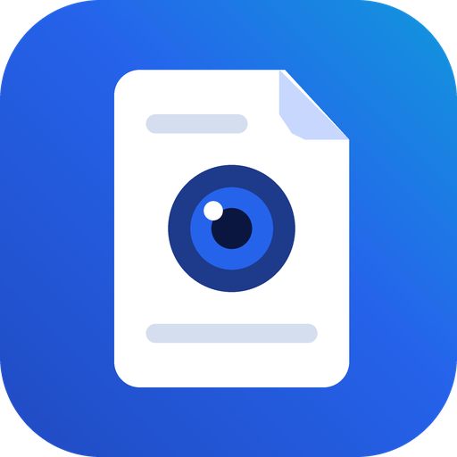
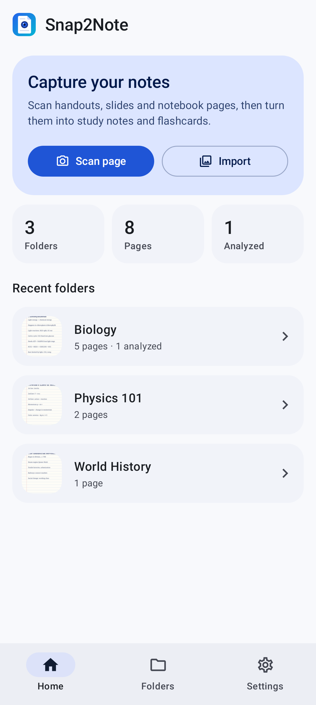
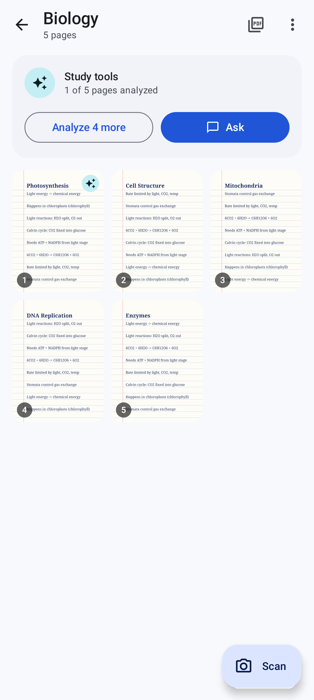
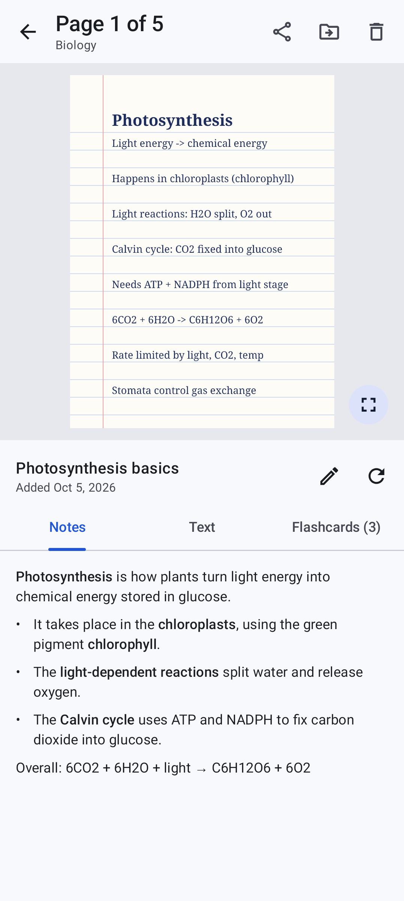
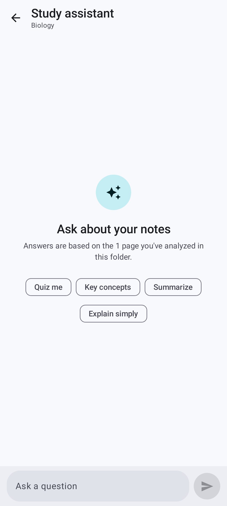
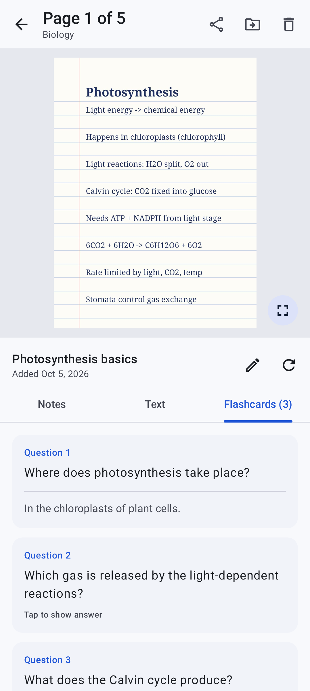
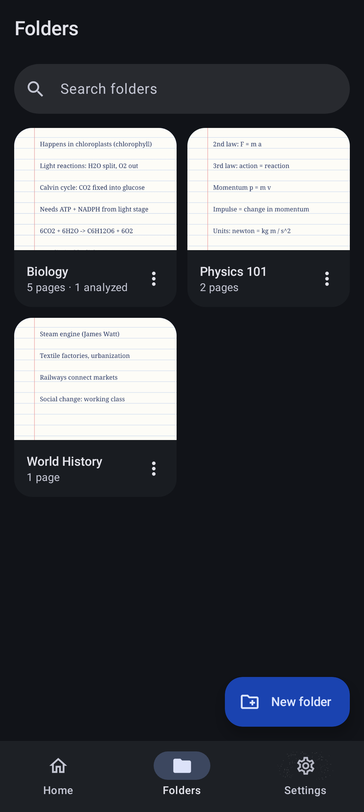
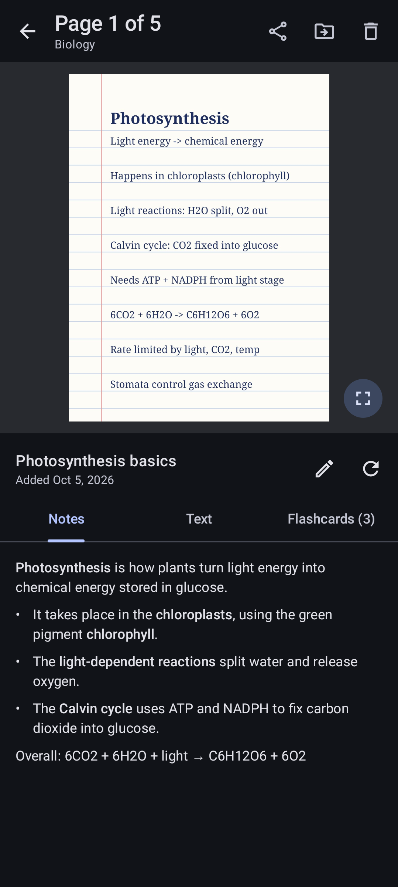
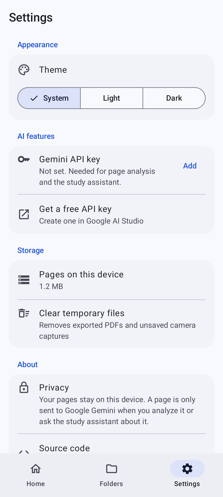

<div align="center">



# Snap2Note

**Scan your study notes, keep them organized, and turn them into explanations and flashcards.**

[](https://github.com/irfansheriffhasan-art/Snap2Note/actions/workflows/build.yml)


[](LICENSE)

[**Download the latest APK**](https://github.com/irfansheriffhasan-art/Snap2Note/releases/latest)

</div>

<p align="center">
  
  
  
  
</p>

## Features

- **Scan or import pages.** Capture handouts, slides and notebook pages with the camera, or import photos from your gallery. Multi-page scanning lets you capture a whole chapter in one go.
- **Organize by subject.** Keep pages in folders. Search folders, rename them, and move pages between them.
- **Study notes from any page.** Gemini reads the page and returns the full text, a clear explanation of the key ideas, and flashcards to test yourself.
- **Study assistant.** Ask questions about a whole folder, get a quick summary, or have it quiz you, with answers based on your own notes.
- **Export and share.** Turn a folder into a single A4 PDF, or share the page images.
- **Private by default.** Pages are stored only on your device. A page is sent to Gemini only when you analyze it or ask the assistant about it.
- **Light and dark themes**, following your system setting or chosen in the app.

<p align="center">
  
  
  
  
</p>

## Install

1. Download `Snap2Note-<version>.apk` from the [latest release](https://github.com/irfansheriffhasan-art/Snap2Note/releases/latest) on your Android phone.
2. Open the file. If Android asks, allow your browser or file manager to install unknown apps.
3. Open **Settings → Gemini API key** in the app and paste a free key from [Google AI Studio](https://aistudio.google.com/apikey) to turn on the AI features. Scanning, folders and PDF export work without a key.

Requires Android 7.0 (API 24) or newer.

## Tech stack

| Area | Libraries |
| --- | --- |
| UI | Jetpack Compose, Material 3, Navigation Compose |
| State | ViewModel, Kotlin coroutines and Flow |
| Storage | Room (folders and pages), app-private files (images) |
| Images | Coil, AndroidX ExifInterface |
| AI | Gemini API over Retrofit, OkHttp and Moshi (code-generated adapters) |
| Testing | JUnit, Robolectric, Roborazzi screenshot tests |

## Project structure

```
app/src/main/java/io/github/irfansheriffhasan/snap2note/
├── ai/          Gemini API client, prompts and response models
├── data/        Room database, repository, settings, image processing
└── ui/
    ├── components/  Reusable composables (dialogs, Markdown, zoomable image, launchers)
    ├── screens/     Home, Folders, Folder, Page, Scan, Save to folder, Study assistant, Settings
    └── theme/       Colors, typography and shapes
```

`NoteViewModel` holds app-wide state (folders, pages, analysis progress, export, settings) and `StudyChatViewModel` holds a single study assistant conversation. Both get their dependencies from `Snap2NoteApplication`.

## Build from source

Requirements: [Android Studio](https://developer.android.com/studio) (or JDK 17+ and the Android SDK).

```bash
git clone https://github.com/irfansheriffhasan-art/Snap2Note.git
cd Snap2Note
./gradlew assembleDebug        # build a debug APK
./gradlew testDebugUnitTest    # run unit and screenshot tests
```

The debug APK is written to `app/build/outputs/apk/debug/`. No API key is needed at build time; each user adds their own key in the app's settings, so no key is ever bundled in the APK.

### Release builds

Release builds are minified with R8 and need a signing key. Create one once and keep it safe, because you need the same key to publish updates:

```bash
keytool -genkeypair -v -keystore signing/snap2note-release.jks -storetype PKCS12 \
  -alias snap2note -keyalg RSA -keysize 4096 -validity 10000
```

Then copy `keystore.properties.example` to `keystore.properties`, fill in the passwords and run:

```bash
./gradlew assembleRelease
```

`keystore.properties` and the `signing/` folder are git-ignored. On CI, the same values come from environment variables (see [`.github/workflows/release.yml`](.github/workflows/release.yml)).

### Publishing a release

Pushing a tag such as `v1.0.0` runs the release workflow, which builds the signed APK and attaches it to a GitHub release. Add these repository secrets first:

| Secret | Value |
| --- | --- |
| `SIGNING_KEYSTORE_BASE64` | The keystore file, base64-encoded (`base64 -w0 signing/snap2note-release.jks`) |
| `SIGNING_STORE_PASSWORD` | Keystore password |
| `SIGNING_KEY_ALIAS` | Key alias (`snap2note`) |
| `SIGNING_KEY_PASSWORD` | Key password |

### Screenshots

The screenshots in this README are generated by `AppScreenshotTest`, which walks through the app with sample notes:

```bash
./gradlew recordRoborazziDebug
```

## License

Released under the [MIT License](LICENSE).
